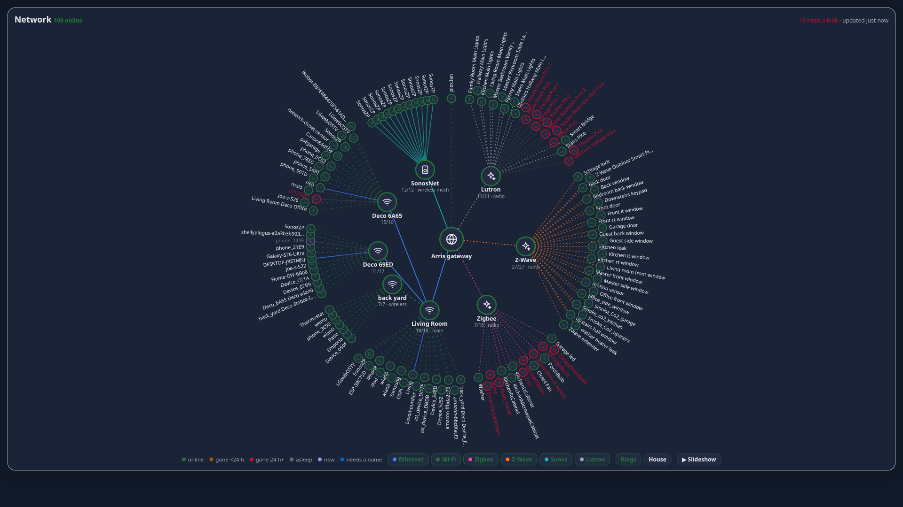
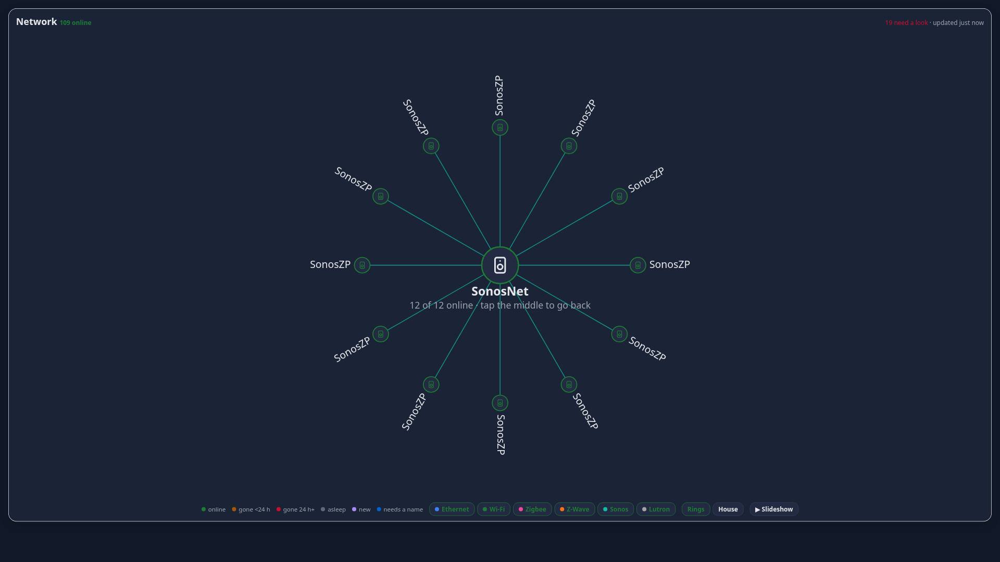
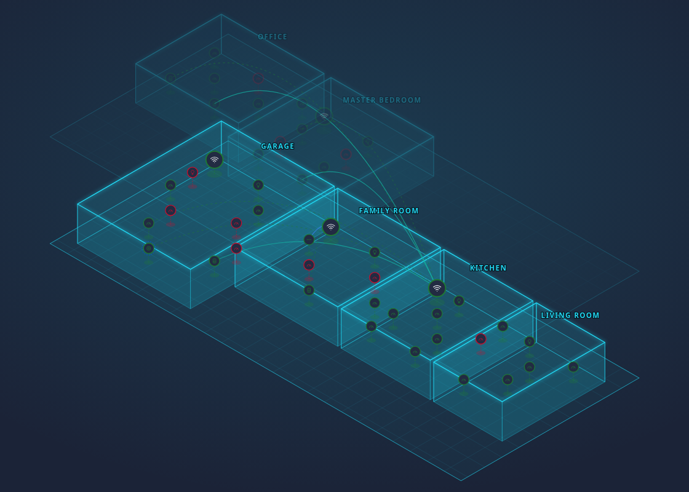

# Network Map Card

A live map of every device on your network for Home Assistant. Nothing to run besides the card: it builds the map in your browser from your `device_tracker` entities and your Zigbee / Z-Wave / Lutron devices.



- **Rings view**: router in the middle, each access point as a spoke, devices around it. Green = online, amber = gone under 24 h, red = gone 24 h+, grey = "allowed to sleep" (TVs, phones, consoles).
- **Zoom**: tap any access point or radio and its devices fan out around it, readable at a glance.
- **Link-type filters**: switch Ethernet, Wi-Fi, Zigbee, Z-Wave, Sonos and Lutron lines on and off in any combination. Ethernet is a solid line, Wi-Fi flows, radios are dotted.
- **SonosNet**: Sonos speakers that look "wired" (SonosNet is Sonos's own wireless mesh) get a hub of their own.
- **Slideshow**: one button cycles every link type, everything, then each hub zoomed in. Good for a wall tablet. It is hidden on phones; set `slideshow: true` / `false` to force it on or off.
- **House view, in 3D**: your floor plan becomes a glowing holographic blueprint, floors stacked as layers, devices floating on stems and links drawn as light arcs. Toggle **3D / Flat**. Put your devices on **your own floor plan**. You provide the image, you drag boxes over it to mark the rooms (the room list comes from your HA areas), and devices land in their room automatically. Drag a dot to move a device. Optional: turn on **Update HA areas** (in Edit rooms) and dropping a device in a room also sets that room as the device's area in Home Assistant.
- **Edit from the map**: tap a device to rename it, mute its "dropped off" alerts, set its room, or hide it. Purple dot = new device, dashed blue ring = "needs a name".





## Looking for auto-discovery instead?

If what you want is "find every device on my network, sweep the subnet, read my switches over SNMP and work out which access point each one is behind", use [NetOrbit](https://github.com/the-scott-davis/netorbit). It does that far better than this card, which only shows what Home Assistant already knows. This card is for a floor-plan view of your own house, Zigbee / Z-Wave / Lutron links, link-type filters and a plain card install with nothing scanning your network.

## Install (HACS)

1. HACS → ⋮ → **Custom repositories** → add `https://github.com/Vansmak/network-map-card`, type **Dashboard** (Lovelace).
2. Install **Network Map Card**, then reload the browser.
3. Edit a dashboard → **Add card** → **Network Map Card** (or use the YAML below).

Manual: copy `dist/network-map-card.js` to `/config/www/` and add `/local/network-map-card.js` as a dashboard resource (type *JavaScript module*).

## What it needs from you

The card draws what Home Assistant already knows, so to get started you only add the integrations you already use:

1. **Your router / Wi-Fi system's integration** (anything that creates `device_tracker` entities with a `mac` or `ip`). Every tracked client becomes a dot.
2. **Zigbee / Z-Wave / Lutron / Thread** come from the device registry (ZHA, Zigbee2MQTT, Z-Wave JS, Lutron Caséta). Nothing to configure.
3. **Optional**: a `gateway_name`, a floor-plan image for House view, and (only if your integration doesn't say) which access point each device is on.

### Everything else (Omada, Sonos, other brands)

- **Nothing is left out.** Any device your router integration tracks shows up as a dot, even when the integration can't say which access point it is on. Those hang off the router until you move them.
- **Omada / Orbi / others that don't expose the AP:** list your access points once under `hubs` by MAC (a `device_tracker` isn't needed), then open a device and tap **Move to an access point**. The card remembers.
- **Sonos:** speakers are normal devices (speaker icon, "asleep" by default). The separate **SonosNet** hub only appears when your router reports Sonos speakers as wired, which is how SonosNet (Sonos's own wireless mesh) usually looks to a Deco. Sonos is recognised from the device name or the HA device registry manufacturer, so it works without the Sonos integration.
- **Device types** (TV, phone, camera, printer, …) come from the device name plus the manufacturer and model in the HA device registry.
- **Not drawn:** Bluetooth, Matter and Thread links, and anything that isn't a `device_tracker` or a Zigbee / Z-Wave / Lutron device. Ask for it in an issue if you need one.

### Which integrations tell the card where a device is connected

The card reads the attributes your integration exposes. It looks for an AP MAC (`ap_mac`, `deco_mac`, `access_point_mac`, `conn_ap_mac`, …) or an AP name (`deco_device`, `ap_name`, `access_point`, …) and groups the client under that access point. Access points are found automatically: any tracker or registry device that clients point to becomes an AP hub.

| Integration | Clients grouped under their access point? | Wired vs Wi-Fi |
|---|---|---|
| TP-Link Deco (HACS `tplink_deco`) | Yes (`deco_mac`) | Yes (`connection_type`) |
| UniFi Network (core) | Yes (`ap_mac`; AP found from its tracker or the device registry) | Wi-Fi when `essid` is present |
| NETGEAR / Orbi (core) | No: HA only exposes ip / mac / hostname | Not exposed |
| TP-Link Omada (core) | No: clients don't expose their AP | Not exposed |
| eero, Fritz!Box, pfSense / OPNsense, Asus, Mikrotik, OpenWrt, Nmap, … | Depends on the integration; not verified | Depends |

I have only tested this against TP-Link Deco on a real network. UniFi is based on reading its source and a simulated setup. If your integration exposes an AP attribute that isn't recognised, open an issue with the attributes from Developer Tools → States and it can be added.

**When the integration doesn't say**, devices hang off your router and you fix them in two taps: open a device, then **Move to an access point** or **Set to Ethernet / Wi-Fi**. The card remembers.

**Floor plan** (House view only), all inside the card, no files to host:
1. Open **House** → **Edit rooms** → **Add a floor plan image** and pick any picture of your home (a photo of a sketch, a Roomba map screenshot, a real plan). It is shrunk and saved with your settings.
2. Choose a room from the dropdown (your HA areas) and drag a box over it on the picture. Repeat for each room; draw a second box for an L-shaped room.
3. Click **Done editing rooms**. Devices in each HA area appear in their room; drag any dot to move it, and drag from the "Not placed" list to place the rest.
4. More than one floor? **Add a floor**, give it a name, and give it its own image.

No image works too: you get a plain grid, and Rings never needs a plan. (YAML `floors[].image` still works if you prefer to host the picture yourself.)

Editing rooms and writing areas back to HA needs an admin user.

## Configuration

```yaml
type: custom:network-map-card
title: Network               # optional
gateway_name: Arris gateway  # your router
height: 720                  # map height in px
floors:                      # optional: one entry per floor
  - name: Downstairs
    image: /local/floor-down.png
  - name: Upstairs
    image: /local/floor-up.png
hubs:                        # optional: access points the integration does not reveal (Deco / UniFi are automatic)
  - entity: device_tracker.garage_ap
    name: Garage AP
    wired: true
  - mac: "aa:bb:cc:dd:ee:ff"
    name: Living room AP
    main: true
ignore:                      # optional: trackers to leave out
  - device_tracker.some_phone
radios: [zigbee, zwave, lutron]   # which radios to draw
sync_areas: false            # default for "Update HA areas"; you can also flip it in the card under Edit rooms (admin only)
slideshow: true              # optional: show / hide the slideshow button (default: desktop only)
# set --network-map-holo-color on the card (card-mod / theme) to change the hologram colour from cyan
storage_key: network_map     # change if you add a second card with different names/rooms
```

How clients are matched to an access point: the tracker attributes `deco_mac`, `ap_mac` or `access_point_mac` (or the AP's name in `deco_device`, `ap_name`, `access_point`). Anything unmatched hangs off the router. Wired vs Wi-Fi comes from `connection_type`, `is_wired` or `wired`.

## Where your edits are saved

Names, hidden devices, rooms, positions and the rooms you draw are saved in Home Assistant under your user (`frontend/set_user_data`, key `network_map`), so they follow you between browsers. A different HA user has their own set.

## Not included (yet)

- Push alerts when a device drops. The "it's allowed to sleep" flag is stored so a blueprint can use it later.
- Per-device ping/latency.
- Floors are separate images; there is no stacked 3D view.

## Credits

Built for a home network of ~120 devices; shared because the map turned out to be the fun part. MIT licensed. Issues and ideas welcome.
